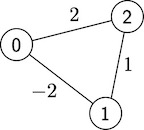

# CMPS 6610 Problem Set 05
## Answers


**Name:** Justin Li


## 1. Shortest shortest paths


**1b) (4 pts)** Work and span

`shortest_shortest_path` is Dijkstra's algorithm with one change: the
"distance" of a path is the pair `(total weight, number of edges)`, and pairs
are compared lexicographically. Two paths with the same weight are then
ordered by edge count, so the fewer-edge path wins every tie.

This is still correct because every edge weight is positive. Extending a path
by an edge of weight `w > 0` turns its pair `(d, e)` into `(d + w, e + 1)`,
which is strictly larger lexicographically. That is the only property
Dijkstra's correctness proof uses, so the first time a vertex is popped from
the heap its pair is minimal: least weight, and among least-weight paths,
fewest edges.

Each vertex is finalized once, and each edge `(v, u)` is relaxed once, when
`v` is finalized. That gives at most `|E|` heap insertions, so the heap holds
at most `|E|` entries, and each `heappush`/`heappop` costs `O(log |E|)`.

- **Work: `O(|E| log |E|) = O(|E| log |V|)`**, the same as Dijkstra (since
  `|E| <= |V|^2`, `log |E| <= 2 log |V|`). Comparing pairs instead of single
  numbers only adds a constant factor.
- **Span: `O(|E| log |E|)`**. Dijkstra is inherently sequential: the next
  vertex to finalize depends on all relaxations performed so far, so the heap
  operations form one dependency chain and the span equals the work.


## 2. Expression Trees


**2a) (3 pts)** Expression tree algorithm with work and span

Scan the expression left to right with a stack, the standard way of parsing a
fully parenthesized expression. Treat a constant such as `-3` as a single
literal.

```
build-tree (E) =
  S = empty stack
  for each token t of E, left to right :
      if t is a literal  : push Leaf(t) onto S
      if t is an operator: push t onto S
      if t is '('        : do nothing
      if t is ')'        : right = pop S; op = pop S; left = pop S
                           push Node(op, left, right) onto S
  return pop S          (* also handle an unparenthesized top level the same way *)
```

Every `)` closes exactly one binary operation, so its two operands are already
complete subtrees on top of the stack.

Each token is pushed and popped `O(1)` times, and there are `O(n)` tokens
(`n` literals, `n - 1` operators, and at most `2(n - 1)` parentheses).

- **Work: `O(n)`**
- **Span: `O(n)`**, since every step depends on the stack left by the previous
  one.

The span can be improved. Computing each token's nesting depth is a prefix sum
(`+1` for `(`, `-1` for `)`), i.e. the `scan` from parenthesis matching in
Problem Set 3: `O(n)` work and `O(log n)` span. Given the depths, finding each
operator's parent amounts to finding the nearest enclosing token of smaller
depth, an *all-nearest-smaller-values* computation, for which known parallel
algorithms take `O(n)` work and `O(log n)` span. That builds the tree in
`O(n)` work and `O(log n)` span.


**2b) (2 pts)** Corresponding arithmetic expression work and span?

Evaluate bottom-up: a leaf takes its variable's value or its constant, and an
internal node applies its operator to its two children's values. The two
subtrees of a node are independent, so they are evaluated in parallel.

- **Work: `O(n)`**, `O(1)` per node.
- **Span: `O(h)`**, where `h` is the height of `T_E`. A node can only be
  evaluated after its children, so the critical path is the longest
  root-to-leaf path:
  - `O(log n)` if the tree is balanced, e.g. `(a+b)*(c+d)`.
  - `O(n)` in the worst case, e.g. `((((a+b)+c)+d)+e)`, which is a path.

This is why the problem says the operators are **associative**. A chain of the
same associative operator can be re-parenthesized into a balanced tree without
changing its value, e.g. `(((a+b)+c)+d) = (a+b)+(c+d)`, which gives depth
`O(log n)` and therefore span `O(log n)`. (For arbitrary expression trees,
parallel *tree contraction* achieves `O(n)` work and `O(log n)` span.)


**2c) (2 pts)** work/span to update a previously computed value

Store at every internal node the value computed in 2b. Changing one variable's
leaf only changes the values on the path from that leaf up to the root; every
other subtree is untouched, so its stored value can be reused. Walk up the
path, recomputing each ancestor from its updated child and the stored value of
its other child.

- **Work: `O(h)`**, i.e. `O(log n)` for a balanced tree and `O(n)` worst case.
- **Span: `O(h)`**. Each ancestor needs its child's new value first, so the
  path is updated sequentially. There is nothing to parallelize, but compared
  with re-evaluating from scratch (`O(n)` work) this is a large saving when the
  tree is balanced.

(If the variable occurs at several leaves, update the union of their
leaf-to-root paths. With `r` occurrences this costs at most `O(min(n, r h))`
work, and the span is still `O(h)` because the paths can be processed level by
level.)


## 3. Improving Dijkstra


**3a) (2 pts)** Maximum depth of a $d$-ary heap

A complete `d`-ary tree has `d^i` nodes at depth `i`, so depths `0..h` hold
`1 + d + ... + d^h = (d^(h+1) - 1) / (d - 1)` nodes. With `n` elements the
maximum depth is

```
h = ceil( log_d( (d - 1) n + 1 ) ) - 1   =   Theta(log_d n)   =   Theta(log n / log d)
```


**3b) (3 pts)** Work done by `delete-min` and `insert` operations in a $d$-ary heap.

- **`insert`: `O(log_d n)`.** The new element starts as the rightmost leaf
  and swaps upward. Each step compares it with its single parent, `O(1)`, and
  there are at most `h = O(log_d n)` steps.
- **`delete-min`: `O(d log_d n)`.** The rightmost leaf moves to the root and
  swaps downward. Each step must find the smallest of the node's `d`
  children, which takes `d - 1` comparisons, i.e. `O(d)`, and there are at most
  `O(log_d n)` steps.

So a larger `d` makes `insert` cheaper (a shallower tree) but makes
`delete-min` more expensive (more children to examine per level). This is the
tradeoff 3c and 3d exploit.


**3c) (3 pts)** New bound on the work for Dijkstra's using $d$-ary heap

Dijkstra performs one `delete-min` per vertex, `|V|` in total, and at most one
`insert` (or decrease-key, which is also a sift-up) per edge relaxation,
`|E|` in total. The heap holds at most `|V|` entries, so

```
W  =  |V| * O(d log_d |V|)   +   |E| * O(log_d |V|)
   =  O( (d |V| + |E|) log_d |V| )
   =  O( (d |V| + |E|) log |V| / log d )
```

The first term is the `delete-min`s and the second the `insert`s. With
`d = 2` this is the familiar `O(|E| log |V|)`.

(In the version from class, which inserts a new heap entry on every relaxation
and skips stale entries instead of using decrease-key, the heap can grow to
`|E|` entries and there can be up to `|E|` `delete-min`s. Replacing `|V|` by
`|E|` in the delete-min term and inside the logs gives
`O(|E| d log_d |E| + |E| log_d |E|)`.)


**3d) (3 pts)** What value of $d$ yields an overall running time of $O(|E|)$?

Choose the average degree:

```
d = |E| / |V| = |V|^epsilon
```

This balances the two terms of 3c, since `d |V| = |E|`:

```
W  =  O( (d |V| + |E|) log_d |V| )  =  O( 2 |E| * log_d |V| )
```

and the logarithm becomes a constant:

```
log_d |V|  =  log |V| / log d  =  log |V| / (epsilon log |V|)  =  1 / epsilon
```

So `W = O(|E| / epsilon) = O(|E|)`, because `epsilon` is a fixed constant in
`(0, 1)`. This uses the decrease-key version of Dijkstra from 3c.

The intuition: with `|E| = |V|^(1+epsilon)` edges, the heap tree can afford
`|V|^epsilon` children per node, and then it is only `1/epsilon = O(1)` levels
deep.


## 4. All-pairs shortest paths using Dynamic Programming

**4a) (2 pts)** Consider the following graph with 3 vertices.



Compute $\mathit{APSP}(i, j, k)$ for all $i, j, k$.

I read the graph as a **directed** cycle in the clockwise direction, following
the figure's alt text ("weights 2, 1, -2 (clockwise)"):

```
0 -> 2  weight  2
2 -> 1  weight  1
1 -> 0  weight -2
```

(If the edges were undirected, the negative edge could be traversed back and
forth, `0 -> 1 -> 0` costs `-4`, so that is a negative cycle and shortest
paths would be undefined. The directed cycle has total weight
`2 + 1 - 2 = 1 > 0`, so no negative cycles.)

`APSP(i, j, k)` allows only vertices `0, ..., k` as **intermediate** vertices.
As a base case, `k = -1` means no intermediates, so only direct edges count
(`APSP(i, i, -1) = 0`, and `inf` where there is no edge). Each table has rows
`i` (from) and columns `j` (to).

**k = -1** (direct edges only)

| i \ j | 0 | 1 | 2 |
|---|---|---|---|
| **0** | 0 | inf | 2 |
| **1** | -2 | 0 | inf |
| **2** | inf | 1 | 0 |

**k = 0** (may pass through 0)

| i \ j | 0 | 1 | 2 |
|---|---|---|---|
| **0** | 0 | inf | 2 |
| **1** | -2 | 0 | **0** |
| **2** | inf | 1 | 0 |

New: `1 -> 0 -> 2` costs `-2 + 2 = 0`.

**k = 1** (may pass through 0, 1)

| i \ j | 0 | 1 | 2 |
|---|---|---|---|
| **0** | 0 | inf | 2 |
| **1** | -2 | 0 | 0 |
| **2** | **-1** | 1 | 0 |

New: `2 -> 1 -> 0` costs `1 - 2 = -1`.

**k = 2** (may pass through 0, 1, 2), i.e. the final answer

| i \ j | 0 | 1 | 2 |
|---|---|---|---|
| **0** | 0 | **3** | 2 |
| **1** | -2 | 0 | 0 |
| **2** | -1 | 1 | 0 |

New: `0 -> 2 -> 1` costs `2 + 1 = 3`. The other candidates through vertex 2,
`0 -> 2 -> 0` (`2 - 1 = 1 > 0`) and `1 -> 2 -> 0` (`0 - 1 = -1 > -2`), do not
improve anything.


**4b) (3 pts)** Relationship between $\mathit{APSP}(i, j, 1)$ and
$\mathit{APSP}(i, j, 2)$. Can you write $\mathit{APSP}(i, j, 2)$ in
terms of $\mathit{APSP}(i, j, 0)$ and $\mathit{APSP}(i, j, 1)$ only?

Going from `k = 1` to `k = 2` adds exactly one new allowed intermediate,
vertex 2. A shortest path that may use `{0, 1, 2}` either:

- does **not** pass through vertex 2, in which case it only uses `{0, 1}` and
  its cost is `APSP(i, j, 1)`; or
- passes through vertex 2 **once**, in which case it splits into `i ~> 2` and
  `2 ~> j`, each using only `{0, 1}`.

So

```
APSP(i, j, 2)  =  min( APSP(i, j, 1),  APSP(i, 2, 1) + APSP(2, j, 1) )
```

Only the `k = 1` table is needed: the `k = 0` information is already contained
in it, since every path through `{0}` is also a path through `{0, 1}`. In the
same way, the `k = 1` table comes from the `k = 0` table:

```
APSP(i, j, 1)  =  min( APSP(i, j, 0),  APSP(i, 1, 0) + APSP(1, j, 0) )
```

Substituting this in writes `APSP(i, j, 2)` purely in terms of `k = 0`
values. You can check both formulas against the tables in 4a; for example
`APSP(0, 1, 2) = min(inf, APSP(0,2,1) + APSP(2,1,1)) = min(inf, 2 + 1) = 3`.


**4c) (3 pts)** Generalize your observation from b) above to give an optimal substructure property for $\mathit{APSP}(i, j, k).$

**Property (Floyd–Warshall).** Assuming no negative cycles, for
`0 <= k <= n - 1`:

```
APSP(i, j, k)  =  min( APSP(i, j, k-1),  APSP(i, k, k-1) + APSP(k, j, k-1) )

APSP(i, j, -1) =  0        if i = j
                  w(i, j)  if (i, j) is an edge
                  inf      otherwise
```

**Proof.** Let `P` be a shortest `i -> j` path whose intermediate vertices all
lie in `{0, ..., k}`. Since there are no negative cycles, we may take `P` to
be simple, so vertex `k` appears on it at most once.

- *`k` is not an intermediate vertex of `P`.* Then all of `P`'s intermediate
  vertices lie in `{0, ..., k-1}`, so `cost(P) = APSP(i, j, k-1)`.
- *`k` appears on `P` exactly once.* Split `P` at `k` into `P1: i ~> k` and
  `P2: k ~> j`. Neither contains `k` as an intermediate vertex, so both use
  only `{0, ..., k-1}`. Moreover, each must be a **shortest** such path
  (cut-and-paste): if some `i ~> k` path `P1'` through `{0, ..., k-1}` were
  cheaper than `P1`, then `P1'` followed by `P2` would be an `i -> j` path
  through `{0, ..., k}` that is cheaper than `P`, a contradiction. (If
  `P1'` and `P2` share vertices, removing the resulting cycle never increases
  the cost, since cycles are non-negative.) The same argument applies to
  `P2`. So `cost(P) = APSP(i, k, k-1) + APSP(k, j, k-1)`.

Both options are realizable paths through `{0, ..., k}`, so the optimum is
their minimum. `[]`

So an optimal path is built from optimal paths to subproblems at level
`k - 1`. Note that the second option is not a path "of length `k`" as the
prompt puts it, but a path whose **largest-numbered intermediate vertex is
`k`**.


**4d) (3 pts)** How many distinct subproblems will be computed from scratch, and
what is the resulting work of this dynamic programming algorithm?

The subproblems are indexed by `i`, `j`, and `k`, each with `n` possible
values (plus the base layer `k = -1`, which is just the adjacency matrix).

- **Distinct subproblems: `n * n * n = n^3`.**
- With memoization, each subproblem is computed once. Given the three values
  it depends on, it takes `O(1)` work: two lookups, one addition, one `min`.

So **work `= O(n^3)`**.

Computed bottom-up, this is the Floyd–Warshall algorithm: a loop over
`k = 0, ..., n-1`, updating the whole `n x n` table at each step. Because
level `k` only reads level `k - 1`, the table can be updated in place, so the
space is only `O(n^2)` rather than `O(n^3)`. As for span, the `n^2` entries of
one level are independent of each other and can be computed in parallel with
`O(1)` span, but the `n` levels must be done in order. So the span is `O(n)`.


**4e) (3 pts)** Compare the work of this algorithm against that of just running
Dijkstra $n$ times. Is our dynamic programming algorithm better than this?

Running Dijkstra from every vertex with a binary heap costs
`n * O(|E| log |V|) = O(n |E| log n)` (with `|V| = n`).

**It depends on how dense the graph is:**

- **Sparse graphs** (`|E| = O(n)`): `n` Dijkstras cost `O(n^2 log n)`, which
  is much better than the DP's `O(n^3)`.
- **Dense graphs** (`|E| = Theta(n^2)`): `n` Dijkstras cost `O(n^3 log n)`, so
  the DP's `O(n^3)` is better by a `log n` factor. With a Fibonacci heap,
  Dijkstra costs `O(|E| + |V| log |V|)` per source, which gives `O(n^3)` total
  on dense graphs, a tie.

The crossover is around `|E| = Theta(n^2 / log n)`. Below that, repeated
Dijkstra wins; above it, the DP does.

But the DP has advantages that the bounds above do not show:

1. **It handles negative edge weights**, as long as there are no negative
   cycles. Dijkstra does not: on the graph in 4a, which has the edge
   `1 -> 0` of weight `-2`, Dijkstra is not guaranteed to be correct. To use
   Dijkstra there, one would first have to reweight the edges with
   Bellman–Ford (Johnson's algorithm).
2. **It is simple, with tiny constants**: three nested loops over a matrix.
3. **It parallelizes well**: span `O(n)`, versus repeated Dijkstra, whose
   per-source runs are each sequential (though the `n` runs are independent
   of each other).

So the DP is not better in general (it loses on sparse graphs), but it is
better for dense graphs and for graphs with negative edge weights.


## 5. Spanning trees

**5a) (3 pts)** Is a solution to MST guaranteed to be a solution to MMET? Why or why not?

**Yes.** Every minimum spanning tree also minimizes the maximum edge weight.

**Proof.** Let `T` be an MST, and let `e = (u, v)` be the heaviest edge of
`T`, with weight `w(e)`. Suppose, for contradiction, that some spanning tree
`T'` has every edge strictly lighter than `w(e)`.

Removing `e` from `T` splits `T` into two components, `S` and `V \ S`. Since
`T'` is a spanning tree, it connects `S` to `V \ S`, so it contains some edge
`e'` crossing this cut, with `w(e') < w(e)`. Then `T - e + e'` is a spanning
tree, because `e'` reconnects the two components, and its weight is

```
w(T) - w(e) + w(e')  <  w(T),
```

which contradicts `T` being an MST. Hence no spanning tree has a smaller
maximum edge than `T`, so `T` is an MMET. `[]`

**The converse is false**: an MMET need not be an MST. Example: a triangle
with edges `a-b` of weight 1, `b-c` of weight 5, and `a-c` of weight 5. Every
spanning tree contains one of the weight-5 edges, so all three spanning trees
have maximum edge 5 and are all MMETs. But `{b-c, a-c}` has total weight 10,
while the MST `{a-b, b-c}` has weight 6. MMET only cares about the single
heaviest edge, while MST cares about all of them.


**5b) (2 pts)** Suppose that the optimal solution to MST is impossible to use for some reason. Describe an algorithm to instead find the next best tree (pseudo-code or English is fine). That is, return the tree with the next lowest weight.

**Key fact.** Some second-best spanning tree differs from the MST `T` in
**exactly one edge**: it is `T - e + f` for a tree edge `e` and a non-tree
edge `f`. (This is the standard exchange argument: given any other spanning
tree, one can repeatedly swap in one of its edges for an MST edge without
increasing the weight, so a cheapest non-MST tree is reachable with a single
swap.)

Adding a non-tree edge `f = (u, v)` to `T` creates exactly one cycle: `f`
together with the tree path from `u` to `v`. To get back a tree, we must
remove an edge on that path, and the cheapest result comes from removing the
**heaviest** edge on the path. So:

```
second-best-tree (G) =
  1. T = MST(G)                              (* Kruskal or Prim *)
  2. for every vertex s, traverse T from s (BFS/DFS), recording for every
     vertex x:
         maxEdge[s][x] = the heaviest edge on the tree path from s to x
  3. for every non-tree edge f = (u, v) :
         candidate(f) = w(T) + w(f) - w(maxEdge[u][v])
  4. pick the f with the smallest candidate(f), and
     return T - maxEdge[u][v] + f
```

If `G` has no non-tree edges, then `G` is itself a tree and there is no other
spanning tree, so we report that instead. If `G` has several MSTs, the
"next best" tree found this way has the same weight as `T`, which is correct:
it is the next tree in sorted order of weight.

(I checked this algorithm against brute-force enumeration of all spanning
trees on 865 random small graphs, and it agreed on every one.)


**5c) (2 pts)** What is the work of your algorithm?

- Step 1, the MST: `O(|E| log |V|)`.
- Step 2: `|V|` traversals of a tree with `|V| - 1` edges, each `O(|V|)`, so
  `O(|V|^2)`. This also fills the `|V| x |V|` table.
- Step 3: `O(1)` per non-tree edge with the table, so `O(|E|)`.
- Step 4: `O(|V|)` to build the new tree.

**Total work: `O(|E| log |V| + |V|^2)`.** If step 1 uses the array-based
version of Prim's algorithm, which takes `O(|V|^2)`, the total is simply
**`O(|V|^2)`**, which is optimal for dense graphs since the table has
`|V|^2` entries.

For comparison, the brute-force approach of deleting each of the `|V| - 1`
MST edges in turn and recomputing an MST without it costs
`O(|V| |E| log |V|)`, e.g. `O(|V|^3 log |V|)` on a dense graph.
